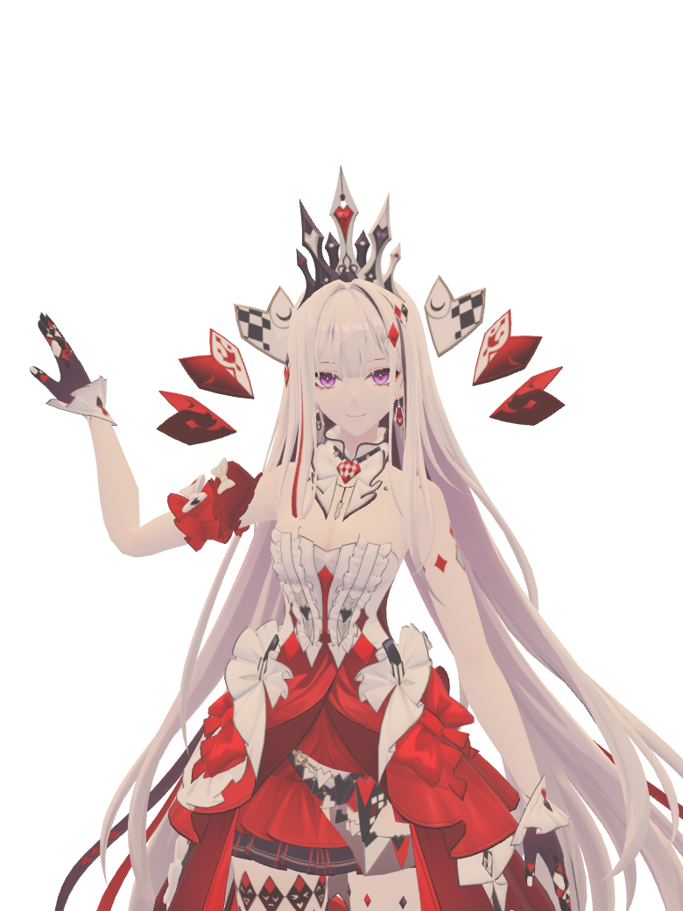
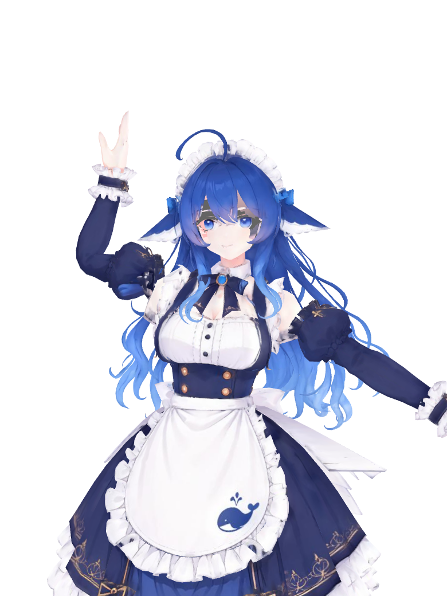
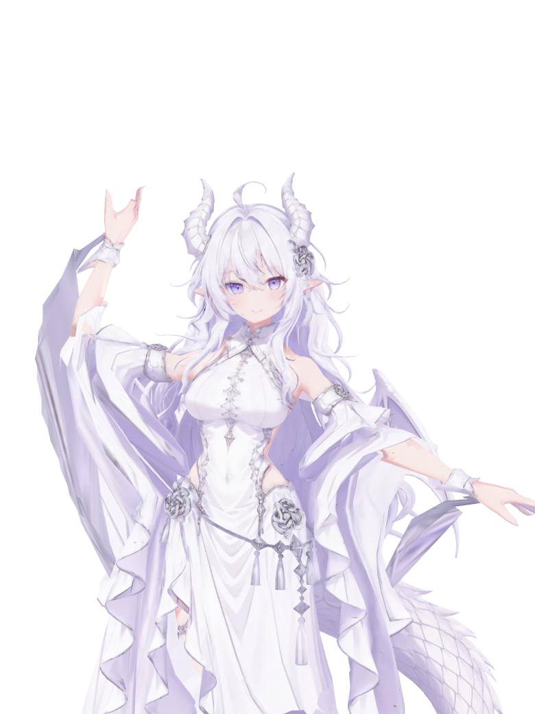

<p align="center"></p>
<h1 align="center">VA · 桌面 3D 角色</h1>

VA 在 macOS 和 Windows 桌面上显示透明悬浮的 3D 角色。可以拖动底部把手移动窗口，拖动角色旋转视角，用滚轮缩放。底部控制条提供缩放和设置。macOS 菜单栏和 Windows 系统托盘可以切换半身视角、隐藏角色、打开鼠标穿透、播放动作和复制角色照片。

VA 优先使用本机的 **星神（星穹铁道）**，并随源码提供 ApprenTice 制作的 **Gemini**。喜欢这些角色，可以到模之屋查看原作者的作品。[阿哈 · 模之屋原帖](https://www.aplaybox.com/details/model/vODgdw8vDdb3) · [AI 娘全家桶 · 模之屋原帖](https://www.aplaybox.com/details/model/3uR3BbUTlkUW)

[角色展示](#3d-角色展示) · [启动](#启动) · [命令行](#命令行) · [桌面互动](#配置与互动) · [智能体与模型](#智能体与模型) · [OpenClaw 和 AstrBot](#openclaw-和-astrbot) · [屏幕与音乐](#视觉-agent-与系统音乐) · [语音和口型](#语音和口型) · [代码结构](docs/architecture.md)

## 3D 角色展示

| 星神 · PMX | DeepSeek 娘 · VRM | Claude 娘 · VRM | GPT 娘 · VRM |
| :---: | :---: | :---: | :---: |
|  |  |  |  |

图片均由 VA 渲染。星神模型版权归 miHoYo，模型编辑为流云景。AI 娘模型由 ApprenTice 制作，角色设计基于 ZipZipPipe 的《大 AI 与小 AI 们》。AI 娘展示图沿用 CC BY-NC-SA 4.0。 [星神模型原帖](https://www.aplaybox.com/details/model/vODgdw8vDdb3) · [AI 娘全家桶](https://www.aplaybox.com/details/model/3uR3BbUTlkUW) · [AI 娘原包署名及许可](assets/models/ATTRIBUTION.md)

## 启动

在仓库里安装依赖需要 Node.js 22.12 或更新版本。macOS 打包还需要 Xcode Command Line Tools。

```bash
npm ci
```

| 操作 | 命令 | 产物或启动入口 |
| --- | --- | --- |
| macOS 从源码启动 | `make dev` | 编译 Swift 助手后打开 VA |
| Windows 从源码启动 | `npm start` | 打开 VA |
| 打包 macOS | `npm run build:mac` | 双击 `dist/VA-darwin-arm64/VA.app` 或 `dist/VA-darwin-x64/VA.app`，取决于构建用的 Mac |
| 打包 Windows x64 | `npm run build:win` | 双击 `dist/VA-win32-x64/VA.exe`，分发时保留整个目录 |
| 打包 Windows ARM64 | `npm run build:win -- --arch=arm64` | 双击 `dist/VA-win32-arm64/VA.exe`，分发时保留整个目录 |
| 在 macOS 一次打包两个平台 | `npm run build:all` 或 `make build-all` | macOS 本机架构的包和 Windows x64 包 |

macOS 的 Swift 助手需要在目标架构的 Mac 上编译。Windows 上可以打包 Windows 版。Windows 版的豆包对话可以使用火山实时语音；本机豆包客户端联动、通话字幕和系统音乐检测由 macOS 助手提供。

如果已经下载了项目所用版本的 Electron ZIP，可用 `make build-all ELECTRON_ZIP_DIR=/路径/到/ZIP目录` 从本地归档打包。

下载阿哈后，把整个模型包解压到系统的「文稿」或「下载」目录，保留原文件夹名及贴图。VA 启动时自动查找 `星穹铁道-阿哈2.pmx`，也可以用 `AVATAR_DIR` 指定模型目录。原包使用规则禁止二次配布，阿哈文件从本机读取。[阿哈下载页](https://www.aplaybox.com/details/model/vODgdw8vDdb3)

安装后也可以直接使用随包提供的 Gemini。模型是静态 GLB，适合旋转预览和拍照。舞蹈和口型需要相应骨骼和表情的模型，可在「设置 → 桌面角色」切换。内置模型遵循 CC BY-NC-SA 4.0。[模型署名和使用条件](assets/models/ATTRIBUTION.md)

在项目根目录也可用 `node bin/va.js start` 启动已打包的本机版本，或用 `node bin/va.js status --json` 查询状态。在 macOS 可把命令链接成 PATH 中的 `va`：

```bash
mkdir -p ~/.local/bin
ln -s "$PWD/bin/va.js" ~/.local/bin/va
```

### 测试与日志

在仓库运行 `npm test` 或 `make test`。测试使用临时配置、模拟截图和模拟 Agent，对外部服务和系统录制权限均无依赖。

VA 将运行日志写到启动目录下的 `logs/va.log`。通过 `va start` 启动时，以执行命令时所在的目录为准。直接打开打包应用且系统提供的工作目录是磁盘根目录时，以 `.app` 或 `.exe` 的所在目录为准。macOS 下可运行 `tail -f logs/va.log` 跟踪日志。

日志每行一条 JSON，记录启动、模型检查、接入切换、对话结果、豆包绑定、动作和传感器状态。错误按错误码记录，聊天正文、截图、录音和 API 密钥仅用于各自的功能。日志达到约 2 MiB 时轮换，上一份保存在 `logs/va.log.1`。

## 命令行

```bash
va actions --supported --json
va wave
va act '侧步摇摆'
va actions --category '说话' --supported
va talk-lively --say '快听我说！'
va express '微笑'
va perform --action '挥手' --expression '微笑' --say '欢迎来到这里！'
va view portrait
va act pose --expression smile --no-wait
va photo --out /tmp/va-photo.png --clipboard --json
va stop
```

`va act` 接受动作编号或配置里的显示名称，`va express` 单独播放表情。当前模型支持的动作都可以直接用 `va <动作编号>` 播放。编号与内置命令同名或多个条目使用同一显示名称时，可用 `va act <编号>` 精确选择动作。

`va actions --supported` 列出当前模型能播放的动作和表情。改好 `performance.json` 后可用 `va actions --reload --supported` 重新读取，新增的编号和显示名称随后即可调用。

「设置 → 动作」按类别切换和预览动作。预览使用动作配置的默认表情。CLI 用 `va actions --category <类别>` 查看同一组动作，类别可填编号或中文名称。

| 类别 | 三个内置动作 |
| --- | --- |
| 舞蹈 `dance` | 侧步摇摆 `dance-side`、转身亮相 `dance-spin`、弹跳挥手 `dance-bounce` |
| 说话 `speech` | 自然交谈 `talk-natural`、活泼讲述 `talk-lively`、思考式说话 `talk-thoughtful` |
| 问候 `greeting` | 挥手 `wave`、点头 `nod`、鞠躬 `bow` |
| 情绪 `emotion` | 喜悦 `happy`、生气 `angry`、难过 `sad` |
| 互动 `interaction` | 大笑 `laugh`、摸摸 `pet`、飞吻 `kiss` |
| 摆拍 `pose` | 摆拍 `pose`、双手比心 `pose-heart`、侧身亮相 `pose-hero` |
| 待机 `idle` | 待机 `idle`、左右观察 `idle-look`、伸懒腰 `idle-stretch` |

可以直接输入「跳个舞吧」「跳三个舞」或「跳一段弹跳挥手」，也可以在菜单栏选择舞步。未指定舞步时，VA 轮换当前支持的舞蹈组动作。经典律动仍可用 `va act dance` 播放。说话组可搭配 `--say` 和指定台词，角色用该动作对应的手势与口型。可用动作取决于当前模型的骨骼和动画。

`va act`、`va say`、`va perform` 默认等演出完成后返回。用 `--no-wait` 可立即获取任务 ID，再用 `va status --json` 查询，或在动作进行时另行调用 `va photo`。已有表演时，新表演返回 `BUSY`。用 `va stop` 可打断，等待该任务的调用会收到 `CANCELED`。

照片是角色当前取景的透明 PNG。命令返回绝对路径，已有文件会保留。指定 `--clipboard` 时也会把图片放到系统剪贴板。更多命令见 `va --help`。

## 接入 Agent 和机器人

- **Codex 或其他支持 Agent Skills 的工具**可以发现 [va-desktop](skills/va-desktop/SKILL.md)，并通过 `va` 或已连接的 MCP 调用桌面角色。
- **MCP 客户端**可添加名为 `va-desktop` 的本机 stdio 服务，命令填 `va`，参数填 `["mcp"]`。若客户端有独立 PATH，用 `va` 的绝对路径，或用 Node.js 绝对路径作为命令并传入 `bin/va.js` 的绝对路径与 `mcp`。可调用 `va_start`、`va_status`、`va_actions`、`va_perform`、`va_stop` 和 `va_photo`，其中照片直接返回 PNG。
- **机器人**可以在同一台 Mac 用子进程调用 `va ... --json`。成功会输出 `{"ok":true,...}`，失败会输出 `{"ok":false,"error":{"code":"...","message":"..."}}` 并返回非零退出码。拿到照片的 `path` 后，用自己的渠道上传附件。远端机器人需要在运行 VA 的这台 Mac 上部署一个能调用 `va` 的桥接进程。

桌面控制在 macOS 使用当前用户独占的 Unix socket，在 Windows 使用带随机凭据的本机回环连接。Windows 从项目目录以 `node bin/va.js` 执行命令。Agent 的受限环境需要允许本机 IPC。

## 配置与互动

macOS 可以用 `make run` 启动已有的打包版本、`make build` 生成本机 `.app`、`make stop` 退出。Windows 可以双击 `VA.exe` 启动，或从托盘菜单退出。

点击角色下方的「设置」、从菜单栏「VA」选择「设置…」、按 **Control + Option + V**，或执行 `va settings`，都可以打开配置窗口。鼠标穿透只作用在角色窗口，底部控制条仍可点击。用控制条的「− / +」可每次调整 5%，设置里的滑块可实时调整 40–110%，也可以执行 `va scale 55`。默认大小为 68%，调整后会保存。关闭穿透时，单击角色触发摸摸反应。拖动模型仍可旋转视角。

「桌面角色 → 界面主题」可在经典、樱花漫画、星夜霓虹之间切换。主题会同时应用到设置窗口和桌面对话气泡。

「设置」中的「桌面模型」可以选择 PMX、VRM、GLB、glTF、FBX 或 OBJ。通过终端切换可用 `va model "/path/to/character.vrm"`，查询用 `va model --json`，恢复默认用 `va model default`。导入成功后会记住模型路径。带外部资源的模型请连同贴图、`.bin` 或 `.mtl` 一起解压，保留相对目录结构。

导入前会检查文件、可见网格和实际渲染结果，检测通过后才替换当前角色。可先点「检测模型…」或执行 `va model-check "/path/to/character.glb" --json`，预查骨骼、表情目标和动画片段。检测失败会保留当前角色。模型能渲染时，缺少部分贴图会显示提醒。

在「设置 → 模型库 → 3D模型」可以预览本机的星神和内置的 Gemini，也可以按名称搜索内置或已导入的模型。要加入其他角色，从模之屋下载并解压 AI 娘全家桶，点「导入解压目录…」，VA 会逐个检测并列出能显示的 VRM 或 GLB。原包提供 Gemini、GLM、Grok、Qwen、Kimi、MiniMax、豆包七款静态 GLB。DeepSeek、Claude 和 GPT 提供的是 Blender 5.2 源文件，可从 Blender 导出为 `model.glb`，与 `model.blend` 放在同一目录，再导入整个模型包。各角色的署名和使用说明见原包内的文件。[AI 娘全家桶原帖](https://www.aplaybox.com/details/model/3uR3BbUTlkUW)

安装 Blender 5.2 或更新版本后，也可以用命令导出这三个角色。脚本保留已有的 GLB，导出后在模型库重新导入解压目录。

```bash
blender --background --factory-startup --disable-autoexec --python-exit-code 1 --python scripts/export-ai-girls.py -- "解压后的 AI 娘全家桶目录"
```

十款 AI 娘都可以生成带动作和表情的 VRM。启用 Blender 的 VRM 插件后，用下面的命令把动作版写入单独的目录，再从「3D模型 → 导入解压目录…」选中该目录。DeepSeek 复用原有骨骼，其余角色按各自的体型绑定。动作版支持内置身体动作、基础表情和五种口型。批量生成的面部变形可在 Blender 中继续细调。[Blender VRM 插件](https://vrm-addon-for-blender.info/en-us/installation/)

```bash
blender --background --disable-autoexec --python-exit-code 1 --python scripts/export-ai-girls-vrm.py -- \
  "解压后的 AI 娘全家桶目录" "AI 娘动作版目录"
```

也可以在系统浏览器打开模之屋或 VRoid Hub，或粘贴两站的模型详情链接。下载其他模型后请保留贴图，用「预览本机文件…」加载。预览通过后可以点「设为桌面角色」。

PMX 和 VRM 的内置动作取决于模型的骨骼和表情。GLB、glTF 和 FBX 可以给动作绑定文件自带的片段。OBJ 适用于静态展示。可用动作和表情会在设置的预览页标出。

### 自定义动作

在「设置 → 动作」打开 `performance.json`。编辑并保存后点「重新加载配置」，也可执行 `va actions --reload`。配置出错时，VA 会保留上一份可用配置。配置路径可用 `VA_PERFORMANCE_CONFIG` 指定。

让 Agent 代做时，使用 [Agent 自定义动作指南](docs/agent-custom-actions.md) 或仓库里的 [VA Skill](skills/va-desktop/SKILL.md)。

动作和表情的编号使用小写英文字母、数字和连字符，首位为字母。下例适用于具有对应 PMX 表情的模型，新增的「眨眼问好」可以从设置预览，也可执行 `va act hello-wink`。

```json
{
  "actions": {
    "hello-wink": {
      "label": "眨眼问好",
      "category": "greeting",
      "seconds": 2.5,
      "motion": "wave",
      "expression": "wink",
      "dialogue": ["嗨，我看到你啦！"]
    }
  },
  "expressions": {
    "wink": {
      "label": "单眼眨眼",
      "pmx": { "ウィンク": 0.8 },
      "vrm": { "blinkLeft": 0.8 }
    }
  }
}
```

- `motion` 可复用内置动作，`clip` 可指定模型里的动画片段，例如 `"clip": "Run"`。骨骼姿势可写成 `"bones": {"头骨名称": [0, 12, 8]}`，三个值分别是 X、Y、Z 轴的角度。骨骼、片段和表情目标沿用模型检测显示的名称。
- 自定义动作可通过 `category` 加入上表中的类别，省略时归入「自定义」。旧动作配置和动作编号仍可使用。
- 表情的权重为 0 至 1。PMX 用 `pmx`，VRM 用 `vrm`，其他带形变目标的模型用 `morphs`。MCP 的 `va_actions` 和命令行的 `va actions` 会列出当前配置。

| 样本 | 下载来源 |
| --- | --- |
| Fox（GLB，含 3 段动画） | [Khronos glTF Sample Assets](https://github.com/KhronosGroup/glTF-Sample-Assets/tree/main/Models/Fox) |
| BoxTextured（glTF，含独立贴图和 BIN） | [Khronos glTF Sample Assets](https://github.com/KhronosGroup/glTF-Sample-Assets/tree/main/Models/BoxTextured) |
| Seed-san（VRM 1.0） | [VRM Consortium](https://github.com/vrm-c/vrm-specification/tree/master/samples/Seed-san) |
| Blocky Characters（含 FBX、OBJ、GLB） | [Kenney 在 OpenGameArt 的下载页](https://opengameart.org/content/3d-rigged-characters) |

在「设置 → 桌面角色」修改「角色名称」。保存后，桌面控制条、菜单、默认台词和默认人设都会使用新名称。人物配置位于 `~/Library/Application Support/VA Desktop/character.json`，初次启动从 [默认人设](config/character.json) 创建。也可通过 `VA_CHARACTER_CONFIG` 指定文件。自定义 `prompt` 或 `dialogue` 时，用 `{{name}}` 引用当前名称。MCP 用 `va_character` 读取人设，命令行可用 `va character --json`。

MCP 的 `va_actions` 和 `va_prompt` 会读取运行中的动作、表情和角色名。改完动作配置后用 `va_reload_actions`，再从 `supported: true` 和 `supportedExpressions` 选择编号。`va_say` 和 `va_perform` 会在角色旁显示对白气泡，表演可以自带台词或使用默认对白。`va_selfie` 成功时只返回 780 × 1040 的透明 PNG，CLI 用 `va selfie --out /tmp/va-selfie.png --json` 获取文件。角色隐藏或 VA 退出时也可以自拍。

## 智能体与模型

从菜单栏「VA → 智能体与模型…」或桌面设置的同名按钮打开，也可执行 `va chat`。VA 同时只启用一种接入。切换时停止原接入并保留配置。选择「关闭」会停止全部自动交互，包括实时语音、屏幕观察和音乐跟随。

- **本地 Agent** 选择 Codex、Claude Code、DeepSeek Harness、OMP 或自定义 Agent。在「连接设置」可绑定会话、设置附加 Prompt 和工作目录。目录留空时使用启动 VA 时所在的目录。VA 使用已安装 Agent 自己的模型服务。
- **豆包客户端** 使用 Mac 上已登录的豆包及当前对话。VA 可以发送文字和显示新的回复，语音输入与朗读由豆包客户端负责。[客户端设置](#本机豆包客户端)
- **火山实时语音** 在「参考音色」配置并切换到实时语音，可在 VA 直接开麦聊天。语音流驱动角色口型，回复同步到桌面气泡。[实时语音设置](#豆包实时语音)
- **模型 API** 列出本机可读取的 Codex CLI、Claude Code 和自定义配置。可直接选择可用的 CLI 配置，也可点「添加配置」填写名称、API 协议、Base URL、模型名、API Key 和附加 Prompt。支持 OpenAI Chat、OpenAI Responses 和 Anthropic Messages。只有 CLI 登录而没有 API Key 时，可继续使用「本地 Agent」或复制为自定义配置并补全。CLI 配置按需读取，密钥不会显示在列表中。
- **AstrBot / OpenClaw** 在本窗口保存目标频道。Bot 调用自己的模型，VA 显示选定频道已经发出的回复。[安装与使用](#openclaw-和-astrbot)

配置保存在 `~/Library/Application Support/VA Desktop/agent.json`。CLI 可用 `va integration [off|local|doubao-client|doubao|api|astrbot|openclaw]` 查询或切换接入方式。手动编辑 JSON 的 `mode` 后重启 VA。

角色人设提供统一语气和动作的默认台词。人设和接入设置里的 `{{name}}` 会替换成当前显示名。运行 `va prompt` 可以查看当前模型的完整动作和表情 Prompt，复制给语音或外部机器人时可运行 `va prompt --voice`。动作请求可以直接触发，Agent 也能根据自己的回复主动安排表演。[Prompt 与动作配置](docs/agent-custom-actions.md#对话如何触发动作)

在本地 Agent 模式，第一次发送会创建会话。VA 会记住每个 Agent 和工作目录的会话 ID，重启后继续使用。可在界面绑定已有的、当前空闲的会话 ID，或点「新会话」解除当前绑定。聊天窗口保留本次 VA 运行中最近 20 轮。回复也会在桌面角色旁显示气泡，最多 300 字。勾选「让角色朗读回复」可以同时听到语音。

```sh
va chat "我们刚才聊到哪里了？" --json
va chat "打个招呼" --speak
va chat-use omp
va chat-status --json
va chat-bind <会话ID>
va chat-new
va chat-cancel
```

配置与视觉、语言模型和频道一起放在 `agent.json` 的 `localAgent` 中。Codex 和 Claude Code 可用各自的 `command` 指定可执行文件。模型可在聊天窗口选择，留空时使用 Agent 自己的配置。Codex 在只读沙箱中运行，续聊时通过 `thread/inject_items` 传入最新指令。Claude Code 的内置工具在 VA 聊天中关闭。模型请求走所选 Agent 已配置的服务。

接入其他本机 Agent 时，在 `localAgent.custom.command` 填可执行文件的绝对路径，在 `args` 填它的参数。VA 直接运行该命令，以工作目录为 cwd，通过 stdin 发送一行 JSON `{"message":"你好","prompt":"角色和附加指令","sessionId":null}`。适配器通过 stdout 返回一个 JSON 对象 `{"reply":"你好","sessionId":"my-session-id"}` 后以 0 退出。续聊会收到相同的 `sessionId`。屏幕观察请求的 `sessionId` 为 `null`，图片在 `image.mime` 和 `image.data`，后者为 Base64。诊断写到 stderr。

### 本机豆包客户端

在 macOS「系统设置 → 隐私与安全性」按所用功能授权。

| 功能 | 权限位置 | 授权给 |
| --- | --- | --- |
| 从 VA 发文字、读取对话回复、调用豆包的朗读按钮 | 辅助功能 | VA |
| 在豆包里打电话或按住空格说话 | 麦克风 | 豆包 |
| 在 VA 显示豆包的语音字幕和口型 | 录屏与系统录音 → 仅系统录音 | VA |
| 让 VA 在豆包客户端通话中识别你说的跳舞请求 | 麦克风 | VA |

如果「辅助功能」列表没有 VA，点「添加」并选择 `dist/VA-darwin-arm64/VA.app`。打开开关时，macOS 可能要求用触控 ID 或登录密码确认。「系统录制权限…」可以从 VA 的字幕设置页打开录制授权。

1. 在「智能体与模型 → 豆包客户端」点「打开豆包」。用豆包内已登录的账号，打开一条已有对话。
2. 给 VA 开启「辅助功能」后，回到 VA 点「绑定当前对话」。关掉设置窗口后仍会在桌面显示新回复。切换接入方式、退出 VA 或点「解除绑定」会结束绑定。
3. 可以从 VA 发送文字，也可以在豆包客户端输入框按住空格说话。新回复会显示在 VA 的对话和桌面气泡里。「用豆包朗读最近回复」调用豆包客户端自己的朗读按钮。
4. 点「同步角色能力」或运行 `va chat-context`，把角色名称、桌面舞步和跳舞机制发到绑定的豆包文字对话。从 VA 发本次绑定后的第一条普通消息时，也会附上能力说明。有在本机安排的跳舞请求时，VA 会在下一条发给豆包的文字里补充动作反馈。

如果普通文字发送失败，先检查 VA 的「辅助功能」，再打开绑定的豆包对话并清理草稿。VA 会查找豆包的「发送」按钮，并确认豆包接受了输入；豆包输入框里已有其他草稿时会保留该草稿。

#### 打电话和字幕

1. 按上表给豆包开启麦克风，并给 VA 开启系统录音。字幕需要 macOS 26，首次启动时可能下载 Apple 的中文识别资源。[Apple 本机语音识别](https://developer.apple.com/documentation/speech/speechanalyzer)
2. 如果 VA 字幕已经开着，先点「停止字幕」。在豆包客户端选择「更多技能 → 打电话」，等电话接通。
3. 回到「VA → 智能体与模型 → 豆包客户端」，点「开始字幕」。豆包播放下一句回复后，字幕会显示在角色旁的气泡和 VA 设置页。通话字幕适用于当前豆包客户端的声音，只有从 VA 发文字或同步某条对话的文字回复才需要绑定该对话。
4. 想在通话里直接让角色跳舞时，开始字幕前勾选「识别麦克风里的跳舞请求」，并允许 VA 使用麦克风。VA 用本机转写判断你说的请求，识别完成后即可跳舞。麦克风识别随字幕停止。

「同步角色能力」会在绑定的文字对话中留下一条消息。豆包客户端的通话模式如何使用文字历史由豆包决定。

VA 通过 Core Audio 采集豆包及其音频助手的输出，中文转写在 Mac 本机完成。豆包的播放音量也会驱动角色口型、点头和说话手势。字幕只包含豆包播放的声音，麦克风仍由豆包客户端使用。关闭 VA 设置窗口后字幕可继续显示。点「停止字幕」、退出 VA 或切换接入方式会释放音频采集。

字幕状态会依次显示等待豆包出声、已收到音频和正在显示字幕。可以在豆包选一条回复点「朗读」测试。听到朗读后如果仍停在等待状态，可以用同页的「系统录制权限…」检查授权。打电话接不通时，可以先停止字幕、重启豆包，再按上述顺序重拨。

打开「让本机模型根据通话内容决定是否跳舞」时，VA 把识别完成的片段交给 Mac 上的模型判断。优先用 Apple Intelligence。Apple Intelligence 不可用时使用 macOS 的中文句向量模型，在语义与表演请求或舞蹈庆祝足够接近时触发。设置页会提示所用方式。这个判断由 VA 在本机依据豆包的语音回复完成。[Apple 设备端模型](https://developer.apple.com/documentation/foundationmodels/systemlanguagemodel)

### 豆包实时语音

1. 在火山引擎开通豆包端到端实时语音（Seeduplex）。在 VA 打开「参考音色 → 火山实时语音」，填入拥有实时语音权限的火山 API Key，或在 VA 的启动环境设置 `VOLC_REALTIME_API_KEY`。音色可以留空使用默认的 Vivi，也可以填写实时语音的音色 ID。附加 Prompt 会与阿哈的人设一起发给豆包。[火山实时语音文档](https://docs.volcengine.com/docs/doubao-voice/end-to-end-real-time-voice-full-duplex-version?lang=zh)
2. 点「保存实时语音配置」，再点「切换到实时语音」和「开始语音对话」。首次使用时，在 macOS「系统设置 → 隐私与安全性 → 麦克风」允许 **VA** 访问。通话中，设置窗口显示双方的字幕，阿哈旁边的气泡同步显示豆包回复，嘴型跟随播放的语音。点「结束」或关闭设置窗口即可停止采集。
3. 说「跳个舞吧」时，VA 收到用户语音的转写就开始跳舞。默认还允许豆包根据聊天内容主动发起表演，例如听到「今天有好消息，庆祝一下吧」。主动表演开关在「火山实时语音」里。

VA 建立实时语音会话时会把桌面角色能跳的舞步发给模型。如果同一轮已经从用户语音识别并安排了舞蹈，跳舞工具会返回已安排的状态。

VA 在桌面采集麦克风和播放音频，豆包在火山引擎生成回复。这个接入使用实时语音 API Key，音色和「参考音色」中的火山 TTS 分别配置。

## OpenClaw 和 AstrBot

在仓库运行 `make integrations` 生成两个插件。在 VA 打开「智能体与模型」，选择一个机器人接入。两个机器人沿用各自的语言模型和人设。VA 把绑定频道中机器人发出的文字显示在阿哈身边，打开「朗读机器人回复」后同时播放语音和口型。

| 接入方式 | 安装与频道绑定 |
| --- | --- |
| OpenClaw | 执行 `openclaw plugins install --link /VA仓库绝对路径/integrations/openclaw`，也可安装 `dist/integrations/openclaw-va-desktop-0.2.0.tgz`。在插件设置中让 `command` 数组指向 VA 命令。在 Telegram 等目标频道用授权账号发送 `/va route`，把返回的 `channel`、`target`、`accountId`、`sessionKey` 填到 VA。 |
| AstrBot | 在管理面板导入 `dist/integrations/astrbot_plugin_va.zip`，设置 `command` 为 Bot 能执行的 VA 命令。用授权账号在目标频道发送 `/va route`，将返回的 UMO 填到 VA 的「目标频道」。 |

Bot 与 VA 同机运行时使用同一个 macOS 登录用户。远端 Bot 可通过 SSH 调用 VA，Docker 可使用仓库里的 [目录桥接](integrations/docker/bridge.py)。两个 Bot 共用一个 Telegram token 时，每次只开启一个 Bot 的 Telegram 适配器。[桥接参数和排查](integrations/README.md)

OpenClaw 按频道的配对或访问策略授权，AstrBot 允许管理员或插件 `allowed_user_ids` 中的账号控制角色。配对后，授权账号可直接在频道输入以下命令。

| 发送 | 结果 |
| --- | --- |
| `/va selfie` | VA 摆拍，机器人只发回一张 780 × 1040 的透明 PNG。桌面角色隐藏时也能拍。 |
| `/va act dance` | 桌面角色跳经典律动并播放默认对白。动作名也可用 `dance-side`、`dance-spin` 或 `dance-bounce`。 |
| `/va act wave` | 桌面上的阿哈挥手并播放默认对白。 |
| `/va say 你好，我是阿哈` | 阿哈在桌面显示这句台词并朗读。 |

在 VA 配置的 OpenClaw 或 AstrBot 频道里，授权用户发「让阿哈跳舞」即可让 VA 表演。插件在机器人调用模型前处理这条请求。AstrBot 注册了 `va_desktop_selfie`，Agent 调用后会把照片发到当前频道。也可以用表中的命令直接自拍或选舞步。

绑定 Telegram 后，可以直接发「给我发张自拍」。AstrBot 和 OpenClaw 都会在调用模型前让 VA 拍照，把 PNG 作为唯一回复发回绑定的聊天。更新 Docker 中的机器人插件后，重启对应的容器让修改生效。

给 VA 单独配置了 OpenClaw 工作区时，可开启 `plugins.entries.va-desktop.config.workspacePrompt`。VA 会在绑定对话进入模型前，把当前角色名和动作清单同步到 `agents.defaults.workspace` 下 `SOUL.md` 的 VA 区块。`SOUL.md` 会用于该工作区的会话。AstrBot 会在授权账号的绑定对话里自动追加同样的 Prompt。机器人发出的「我来挥手」等回复会在 VA 上触发对应动作。[OpenClaw 工作区](https://docs.openclaw.ai/concepts/agent-workspace)

## 视觉 Agent 与系统音乐

在 VA 的「设置 → 屏幕与音乐」分别开启屏幕观察和音乐跟随。两项功能默认关闭，角色隐藏时暂停。观察间隔可选 `10s`、`30s`、`1min`、`5min`、`10min`、`30min`、`1h`、`6h`、`24h`，默认 `10s`。截屏按间隔发起，分析较慢时只保留一张最新待处理截图。也可用 `va sense interval 30`、`va sense screen on` 和 `va sense music on`，状态可用 `va senses --json` 查询。首次使用时，在 macOS 的「隐私与安全性 → 屏幕与系统音频录制」授权 VA，然后退出并重新启动。源码模式下，macOS 可能将授权归给启动 VA 的终端。

屏幕观察跟随当前接入。本地 Agent 模式只把截图交给当前选择的 Agent，选用远端模型时可能把画面发送给其模型服务。模型 API 模式使用当前 API 配置的「屏幕识别」模型，远程 API 需要 HTTPS 并勾选「允许发截图到远端视觉模型」。豆包客户端、火山实时语音及机器人接入期间，屏幕观察暂停。开启观察后，MCP 客户端可用 `va_observe` 请求一次观察并取得文字结果，用 `va_senses` 查看状态。

macOS 上已选用一种交互接入时，可独立开启音乐跟随。音频分类在本机进行。

音乐识别使用 macOS 的本机音频分类，分析系统输出。检测到音乐会播放角色的预设舞步，音乐停止或关闭开关时会停下。鼠标穿透关闭时，点角色可以打断自动动作并听到摸摸回应。桌面打包会编译音频组件，源码开发可用 `make dev` 编译并启动。

## 语音和口型

「设置 → 参考音色」可选择 **macOS 系统音色**或 **火山 TTS**。「试听当前音色」用选定音色朗读一段台词。台词朗读用于点击摸摸、手动动作、CLI、MCP 和启用了朗读的 Agent 或机器人回复。

同一页的「说话风格」可选自然聊天、活泼雀跃、轻声思考或舞台演说。带口型的角色在静音文字回复中会按文字节奏开合嘴巴，朗读时跟随音频。语音可与挥手、跳舞等显式动作同时播放。

### 开启火山 TTS

1. 在火山引擎开通语音合成，准备 API Key 和该资源支持的 Speaker ID。标准语音合成选择 `seed-tts-2.0`。已有火山复刻音色时，选择 `seed-icl-2.0` 并填写该音色的 Speaker ID。[火山语音合成接口](https://docs.volcengine.com/docs/doubao-voice/unidirectional-streaming-text-to-speech-http?lang=zh)
2. 在「设置 → 参考音色」选择「火山 TTS」，填入 API Key 和 Speaker ID，选中资源，再点「保存并使用火山」。API Key 也可通过 VA 启动进程的 `VOLC_TTS_API_KEY` 提供。
3. 点击「试听当前音色」确认可播放。要听 Telegram 的机器人回复，在 VA 的频道配置中打开「朗读机器人回复」。

VA 通过 HTTPS 将朗读文本提交给火山引擎。语音设置保存在 `~/Library/Application Support/VA Desktop/voice.json`，也可通过 `VA_VOICE_CONFIG` 指定位置。火山服务请求失败时，日常对白回退到系统音色，试听会显示错误。

### 本地参考录音

本地 Qwen3-TTS 音色模仿已因合成耗时停用。先前导入的阿哈原声仍可通过「本地原声 → 播放参考原声」播放，也可导入新的 WAV、M4A 或 MP3。参考录音保存在本机，火山 TTS 读出的音色由填写的 Speaker ID 决定。

## 半身视角

「设置 → 角色视角」可选择全身或半身，重启会恢复上次视角。也可执行 `va view portrait` 或 `va view full`。
