<p align="center"></p>
<h1 align="center">VA · 桌面 3D 角色</h1>

VA 在 macOS 和 Windows 桌面上显示透明悬浮的 3D 角色。鼠标靠近时会显示顶部角色名和底部控制条，拖动名字或底部把手可移动角色。拖动模型可以旋转视角，用滚轮可以缩放。菜单栏或系统托盘可以切换半身视角、隐藏角色、打开鼠标穿透、播放动作和复制角色照片。

[默认形象](#默认形象) · [角色展示](#3d-角色展示) · [启动](#启动) · [命令行](#命令行) · [桌面互动](#配置与互动) · [智能体接入](#智能体接入) · [OpenClaw 和 AstrBot](#openclaw-和-astrbot) · [屏幕与音乐](#视觉-agent-与系统音乐) · [语音和口型](#语音和口型) · [Agent 使用指南](AGENTS.md) · [代码结构](docs/architecture.md) · [许可证](#许可证)

## 默认形象

首次启动 VA 时会显示 **VA 封面角色**。下面是默认模型在 VA 中渲染的正面和背面。

<p align="center">
  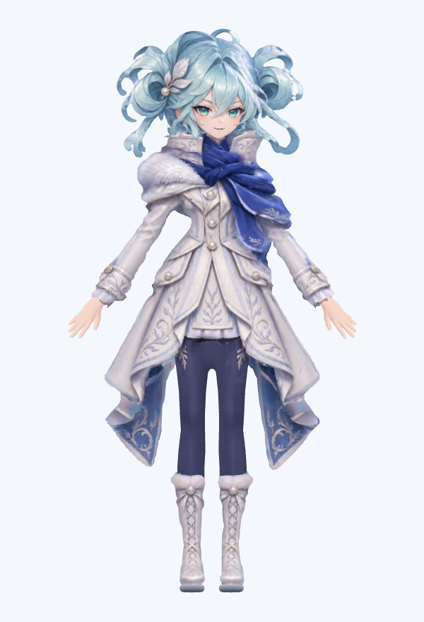
  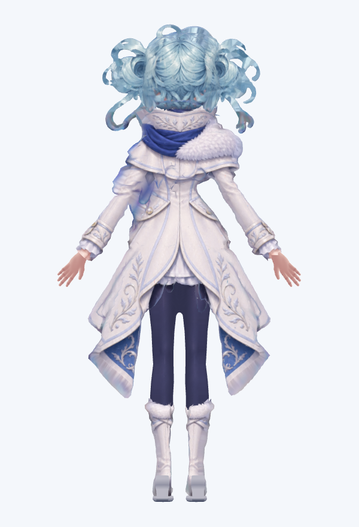
</p>

安装包内置 VA 封面角色作为默认模型。文件在项目的 `assets/models/VA Cover.vrm`，打包后位于 `VA.app/Contents/Resources/app.asar` 内的同一相对路径。运行 `va model --json` 可以查看当前加载的模型和路径。[下载默认形象](assets/models/VA%20Cover.vrm)

## 3D 角色展示

| 星神 · PMX | DeepSeek 娘 · VRM | Claude 娘 · VRM | GPT 娘 · VRM |
| :---: | :---: | :---: | :---: |
|  |  |  |  |

图片均由 VA 渲染。星神模型版权归 miHoYo，模型编辑为流云景。AI 娘模型由 ApprenTice 制作，角色设计基于 ZipZipPipe 的《大 AI 与小 AI 们》。AI 娘展示图沿用 CC BY-NC-SA 4.0。 [星神模型原帖](https://www.aplaybox.com/details/model/vODgdw8vDdb3) · [AI 娘全家桶](https://www.aplaybox.com/details/model/3uR3BbUTlkUW) · [AI 娘原包署名及许可](assets/models/ATTRIBUTION.md)

## 启动

macOS 13 或更新版本的 Apple 芯片 Mac 可下载 DMG，把 `VA.app` 拖到「应用程序」后打开。豆包实时通话字幕需要 macOS 26 和可用的本机中文语音识别。[GitHub Releases](https://github.com/yincongcyincong/VA/releases/latest)

在仓库里安装依赖需要 Node.js 22.12 或更新版本。编译 Swift 助手和制作 DMG 需要目标架构的 Mac、Xcode Command Line Tools 和 macOS 26 SDK。

```bash
npm ci
```

| 操作 | 命令 | 产物或启动入口 |
| --- | --- | --- |
| macOS 从源码启动 | `make dev` | 编译 Swift 助手后打开 VA |
| 打包 macOS 应用 | `bash scripts/package.sh app` | `dist/VA-darwin-<架构>/VA.app` |
| 打包 macOS 安装盘 | `bash scripts/package.sh dmg` | `dist/VA-<版本>-mac-<架构>.dmg` 和 `dist/SHA256SUMS.txt` |
| 打包机器人插件 | `bash scripts/package.sh integrations` | `dist/integrations/` 中的 AstrBot ZIP 和 OpenClaw TGZ |
| 打包 Windows | `npm run build:win` | 打开 `dist/VA-win32-x64/VA.exe` 或 `dist/VA-win32-arm64/VA.exe`，保留同目录下的运行文件 |

Swift 助手需要在目标架构的 Mac 上编译，为豆包客户端联动、通话字幕和系统音乐检测提供支持。

Windows 版可用 `npm run build:win -- --arch=x64` 或 `--arch=arm64` 指定目标架构。本机朗读使用 Windows 已安装的 SAPI 音色。原生功能限制及本机测试记录见 [WIN.md](WIN.md)。

在设置页右上角点击「退出 VA」，或运行 `make stop`，即可结束当前 VA 进程。

直接运行 `bash scripts/package.sh` 会生成 DMG，缺少项目依赖时会先运行 `npm ci`。如果已缓存对应的 Electron ZIP，可运行 `ELECTRON_ZIP_DIR=/路径/到/ZIP目录 bash scripts/package.sh dmg`。

如需使用星神，把阿哈模型包解压到系统的「文稿」或「下载」目录，保留原文件夹名和贴图。VA 启动时会将找到的 `星穹铁道-阿哈2.pmx` 加入模型库，也可以用 `AVATAR_DIR` 指定模型目录。原包使用规则禁止二次配布，阿哈文件从本机读取。[阿哈下载页](https://www.aplaybox.com/details/model/vODgdw8vDdb3)

封面角色是从封面设计重建的带贴图 VRM，支持骨骼动作、口型和表情。已有模型选择会随设置保存。可用 `va model default` 或在模型库选择「VA 封面角色」恢复默认。项目里的 AI 娘动作版放在 `assets/models/ai-girls/<角色目录>/model.vrm`，模型库会自动发现它们。[模型制作与署名](assets/models/ATTRIBUTION.md)

在项目根目录也可用 `node bin/va.js start` 启动已打包的本机版本，或用 `node bin/va.js status --json` 查询状态。在 macOS 可把命令链接成 PATH 中的 `va`：

```bash
mkdir -p ~/.local/bin
ln -s "$PWD/bin/va.js" ~/.local/bin/va
```

### 测试与日志

在仓库运行 `npm test` 或 `make test`。测试使用临时配置、模拟截图和模拟 Agent，对外部服务和系统录制权限均无依赖。

在 Node.js 26 下运行 `npm run test:coverage`，统计 `bin/`、`desktop/`、`lib/` 和 `integrations/` 下的 JavaScript 覆盖率，包含测试从未加载的文件。

在 macOS 26 的桌面会话中运行 `npm run test:desktop`，用临时配置和模拟麦克风测试模型升级与会话绑定。通过 `VA_TEST_ASAR` 指定打包后的 `app.asar`，同一命令也会测试包内代码和模型清单。

VA 将运行日志写到启动目录下的 `logs/va.log`。通过 `va start` 启动时，以执行命令时所在的目录为准。直接打开打包应用且系统提供的工作目录是磁盘根目录时，以 `.app` 的所在目录为准。可运行 `tail -f logs/va.log` 跟踪日志。

日志每行一条 JSON，记录启动、模型检查、接入切换、对话结果、豆包绑定、动作和传感器状态。错误按错误码记录，聊天正文、截图、录音和 API 密钥仅用于各自的功能。日志达到约 2 MiB 时轮换，上一份保存在 `logs/va.log.1`。

## 命令行

### 从命令行和 MCP 配置 VA

运行 `va config list --json` 查看配置组、操作、参数 JSON Schema 和示例。读取和修改配置需运行 VA。用 `get` 查看，用 `set` 合并变更，用 `run` 执行导入、绑定等操作。保存后即时应用。读取音色和接入配置时，密钥字段仅显示配置状态。

| 配置组 | 可操作内容 |
| --- | --- |
| `desktop` | 主题、说话风格、缩放、视角、窗口位置、鼠标穿透、屏幕观察、间隔和音乐 |
| `character` | 显示名、角色 Prompt 和默认台词 |
| `actions` | 按编号合并动作和表情，`null` 删除单个覆盖 |
| `voice` | 系统音色、ZipVoice、火山 TTS 和动作朗读开关 |
| `agent` | 接入方式、本地 Agent 的命令、机器人路由和豆包通话字幕选项 |
| `model` | 使用模型文件或模型库编号，路径设为 `null` 恢复默认 |

```bash
va config get desktop --json
va config set desktop '{"view":"portrait","scale":55,"screenInterval":30}' --json
va config set agent '{"mode":"local","localAgent":{"provider":"claude"}}' --json
va config get character --json
va config run system-voices --json
va config run model-library --json
va config set model '{"id":"va-cover"}' --json
```

带密钥的 JSON 可用 `--file <文件>` 或 `--stdin` 传入。MCP 对应工具为 `va_config_list`、`va_config_get`、`va_config_set` 和 `va_config_run`。将 [VA Desktop Skill](skills/va-desktop/SKILL.md) 提供给智能体，即可按相同配置组操作。

```bash
va config set desktop '{"windowPosition":{"x":100,"y":200}}' --json
va config set desktop '{"windowPosition":null}' --json
va config run model-preview '{"id":"va-cover"}' --json
va config run agent-voice-status --json
va config run agent-voice-start --json
va config run agent-voice-stop --json
va config run deepseek-install-role --json
va config run permissions-status --json
va config run permissions-open '{"kind":"microphone"}' --json
```

窗口坐标使用 macOS 的全局桌面坐标，允许副屏使用负坐标，`null` 恢复主屏幕默认位置。模型预览在设置窗口中打开，可旋转和缩放，也可传 `{"path":"/绝对路径/角色.vrm"}`。麦克风监听需要已绑定的本地 Agent 会话；macOS 需要 26 或更新版本，Windows 需要本机语音识别引擎和麦克风访问权限。DeepSeek 能力安装需要选中并绑定 DeepSeek Harness。豆包客户端可用 `doubao-client-open` 打开，用 `doubao-client-read` 读取当前绑定对话的最新回复。

`permissions-open` 接受 `screen`、`microphone`、`camera` 或 `accessibility`，由用户在 macOS 系统设置中授权。OpenClaw 和 AstrBot 的 VA 端频道可通过 `agent.channels` 设置，机器人凭据、插件权限和部署参数在对应服务的配置中管理。

### 操作桌面角色

```bash
va actions --supported --json
va wave
va act '侧步摇摆'
va actions --category '说话' --supported
va say '快听我说！'
va express '微笑'
va perform --action '挥手' --expression '微笑'
va view portrait
va act pose --expression smile --no-wait
va photo --out /tmp/va-photo.png --clipboard --json
va stop
```

`va act` 接受动作编号或配置里的显示名称，`va express` 单独播放表情。当前模型支持的动作都可以直接用 `va <动作编号>` 播放。编号与内置命令同名或多个条目使用同一显示名称时，可用 `va act <编号>` 精确选择动作。

`va actions --supported` 列出当前模型能播放的动作和表情。改好 `performance.json` 后可用 `va actions --reload --supported` 重新读取，新增的编号和显示名称随后即可调用。

「设置 → 动作」按类别切换和预览动作。预览使用动作配置的默认表情。CLI 用 `va actions --category <类别>` 查看同一组动作，类别可填编号或中文名称。

| 类别 | 三个内置动作 |
| --- | --- |
| 舞蹈 `dance` | 侧步摇摆 `dance-side`、转身亮相 `dance-spin`、弹跳挥手 `dance-bounce` |
| 说话 `speech` | 自然交谈 `talk-natural`、活泼讲述 `talk-lively`、思考式说话 `talk-thoughtful` |
| 问候 `greeting` | 挥手 `wave`、点头 `nod`、鞠躬 `bow` |
| 情绪 `emotion` | 喜悦 `happy`、生气 `angry`、难过 `sad` |
| 互动 `interaction` | 大笑 `laugh`、摸摸 `pet`、飞吻 `kiss` |
| 摆拍 `pose` | 摆拍 `pose`、双手比心 `pose-heart`、侧身亮相 `pose-hero` |
| 待机 `idle` | 待机 `idle`、左右观察 `idle-look`、伸懒腰 `idle-stretch` |

可以直接输入「跳个舞吧」「跳三个舞」或「跳一段弹跳挥手」，也可以在菜单栏选择舞步。未指定舞步时，VA 轮换当前支持的舞蹈组动作。经典律动仍可用 `va act dance` 播放。动作静默执行。开启自动朗读时，VA 在动作完成后朗读 Agent 的最终回复。可用动作取决于当前模型的骨骼和动画。

`va act`、`va say`、`va perform` 默认等演出完成后返回。用 `--no-wait` 可立即获取任务 ID，再用 `va status --json` 查询，或在动作进行时另行调用 `va photo`。已有表演时，新表演返回 `BUSY`。用 `va stop` 可打断，等待该任务的调用会收到 `CANCELED`。

照片是角色当前取景的透明 PNG。命令返回绝对路径，已有文件会保留。指定 `--clipboard` 时也会把图片放到系统剪贴板。更多命令见 `va --help`。

## 接入 Agent 和机器人

- **Codex 或其他支持 Agent Skills 的工具**可以发现 [va-desktop](skills/va-desktop/SKILL.md)，并通过 `va` 或已连接的 MCP 调用桌面角色。
- **MCP 客户端**可添加名为 `va-desktop` 的本机 stdio 服务，命令填 `va`，参数填 `["mcp"]`。若客户端有独立 PATH，用 `va` 的绝对路径，或用 Node.js 绝对路径作为命令并传入 `bin/va.js` 的绝对路径与 `mcp`。可调用 `va_start`、`va_status`、`va_actions`、`va_perform`、`va_stop` 和 `va_photo`，其中照片直接返回 PNG。
- **机器人**可以在同一台 Mac 用子进程调用 `va ... --json`。成功会输出 `{"ok":true,...}`，失败会输出 `{"ok":false,"error":{"code":"...","message":"..."}}` 并返回非零退出码。拿到照片的 `path` 后，用自己的渠道上传附件。远端机器人需要在运行 VA 的这台 Mac 上部署一个能调用 `va` 的桥接进程。

桌面控制在 macOS 使用当前用户独占的 Unix socket，在 Windows 使用命名管道。Agent 的受限环境需要允许本机 IPC。

## 配置与互动

可以用 `make run` 启动已有的打包版本、`make build` 生成本机 `.app`、`make stop` 退出。

鼠标靠近角色或底部控制条所在位置时，顶部显示角色名，底部显示拖动把手和设置齿轮。拖动名字或把手移动角色，重启后会回到上次摆放的位置。点击齿轮可打开设置，开启鼠标穿透时也可使用。还可以从菜单栏「VA」选「设置…」、按 **Control + Option + V** 或执行 `va settings`。设置里的「角色大小」滑块可实时调整 40–110%，也可以执行 `va scale 55`。默认大小为 68%，调整后会保存。关闭穿透时，单击角色触发摸摸反应。拖动模型仍可旋转视角。

「桌面角色 → 界面主题」可在经典、樱花漫画、星夜霓虹之间切换。主题会同时应用到设置窗口和桌面对话气泡。

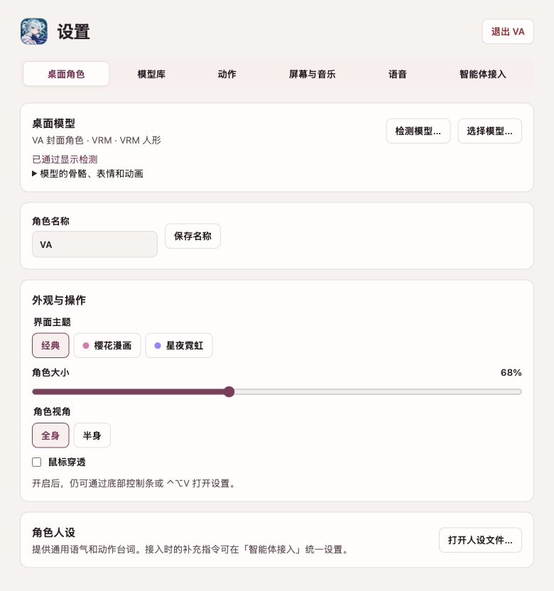

「设置」中的「桌面模型」可以选择 PMX、VRM、GLB、glTF、FBX 或 OBJ。通过终端切换可用 `va model "/path/to/character.vrm"`，查询用 `va model --json`，恢复默认用 `va model default`。导入成功后会记住模型路径。带外部资源的模型请连同贴图、`.bin` 或 `.mtl` 一起解压，保留相对目录结构。

导入前会检查文件、可见网格和实际渲染结果，检测通过后才替换当前角色。可先点「检测模型…」或执行 `va model-check "/path/to/character.glb" --json`，预查骨骼、表情目标和动画片段。检测失败会保留当前角色。模型能渲染时，缺少部分贴图会显示提醒。

在「设置 → 模型库 → 3D模型」可以按名称搜索、预览并选用角色。源码仓库的 [`assets/models/ai-girls`](assets/models/ai-girls/) 收录 DeepSeek、Claude、GPT、Gemini、GLM、Grok、Qwen、Kimi、MiniMax 和豆包的动作版 VRM。源码运行和 Windows 便携包会直接显示这十款模型。使用 macOS 安装包时，下载仓库后点「导入解压目录…」，选择其中的 `assets/models/ai-girls`。[模型授权与改动说明](assets/models/ai-girls/LICENSE.md) · [AI 娘全家桶原帖](https://www.aplaybox.com/details/model/3uR3BbUTlkUW)

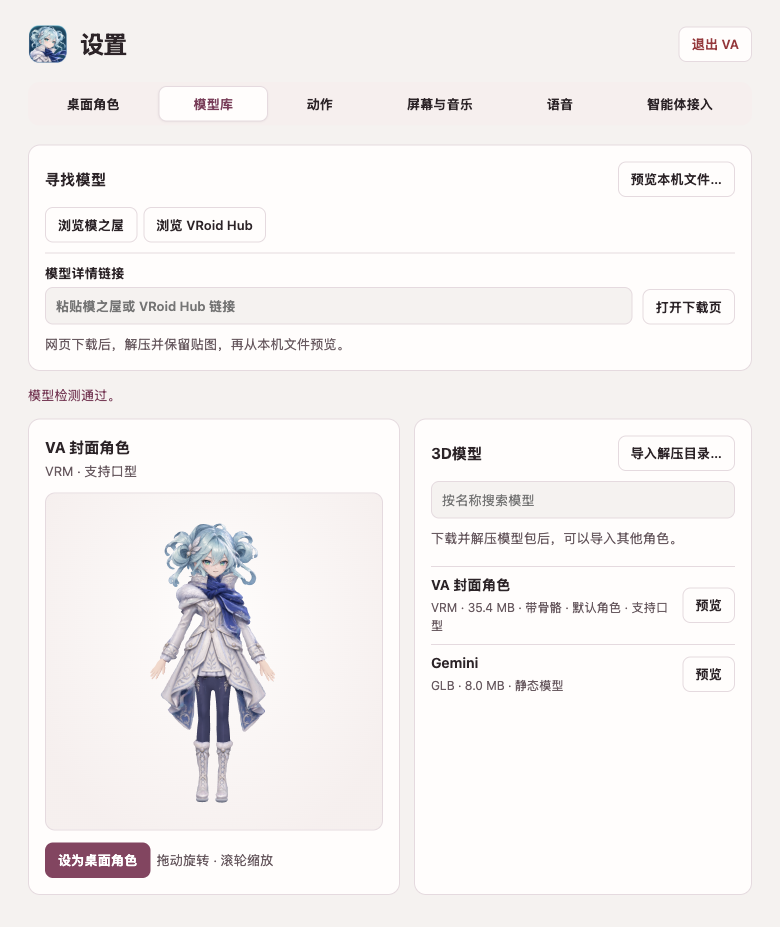

原包提供七款静态 GLB，DeepSeek、Claude 和 GPT 提供 Blender 5.2 源文件。安装 Blender 5.2 或更新版本后，可以用以下命令为这三款导出 GLB。脚本保留已有的 GLB，导出后在模型库重新导入解压目录。

```bash
blender --background --factory-startup --disable-autoexec --python-exit-code 1 --python scripts/export-ai-girls.py -- "解压后的 AI 娘全家桶目录"
```

动作版支持内置舞步、基础表情和五种口型。需要从原包重新生成 VRM 时，启用 Blender 的 VRM 插件，再将文件导出到另一个目录。[Blender VRM 插件](https://vrm-addon-for-blender.info/en-us/installation/)

```bash
blender --background --disable-autoexec --python-exit-code 1 --python scripts/export-ai-girls-vrm.py -- \
  "解压后的 AI 娘全家桶目录" "动作版输出目录"
```

也可以在系统浏览器打开模之屋或 VRoid Hub，或粘贴两站的模型详情链接。下载其他模型后请保留贴图，用「预览本机文件…」加载。预览通过后可以点「设为桌面角色」。

PMX 和 VRM 的内置动作取决于模型的骨骼和表情。GLB、glTF 和 FBX 可以给动作绑定文件自带的片段。OBJ 适用于静态展示。可用动作和表情会在设置的预览页标出。

### 自定义动作

在「设置 → 动作」打开 `performance.json`。编辑并保存后点「重新加载配置」，也可执行 `va actions --reload`。配置出错时，VA 会保留上一份可用配置。配置路径可用 `VA_PERFORMANCE_CONFIG` 指定。

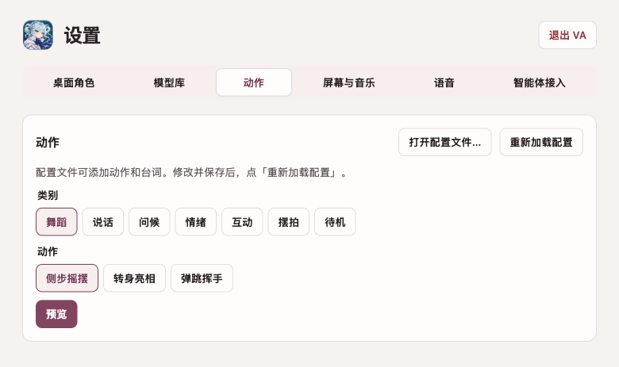

让 Agent 代做时，使用 [Agent 自定义动作指南](docs/agent-custom-actions.md) 或仓库里的 [VA Skill](skills/va-desktop/SKILL.md)。

动作和表情的编号使用小写英文字母、数字和连字符，首位为字母。下例适用于具有对应 PMX 表情的模型，新增的「眨眼问好」可以从设置预览，也可执行 `va act hello-wink`。

```json
{
  "actions": {
    "hello-wink": {
      "label": "眨眼问好",
      "category": "greeting",
      "seconds": 2.5,
      "motion": "wave",
      "expression": "wink",
      "dialogue": ["嗨，我看到你啦！"]
    }
  },
  "expressions": {
    "wink": {
      "label": "单眼眨眼",
      "pmx": { "ウィンク": 0.8 },
      "vrm": { "blinkLeft": 0.8 }
    }
  }
}
```

- `motion` 可复用内置动作，`clip` 可指定模型里的动画片段，例如 `"clip": "Run"`。骨骼姿势可写成 `"bones": {"头骨名称": [0, 12, 8]}`，三个值分别是 X、Y、Z 轴的角度。骨骼、片段和表情目标沿用模型检测显示的名称。
- 自定义动作可通过 `category` 加入上表中的类别，省略时归入「自定义」。旧动作配置和动作编号仍可使用。
- 表情的权重为 0 至 1。PMX 用 `pmx`，VRM 用 `vrm`，其他带形变目标的模型用 `morphs`。MCP 的 `va_actions` 和命令行的 `va actions` 会列出当前配置。

| 样本 | 下载来源 |
| --- | --- |
| Fox（GLB，含 3 段动画） | [Khronos glTF Sample Assets](https://github.com/KhronosGroup/glTF-Sample-Assets/tree/main/Models/Fox) |
| BoxTextured（glTF，含独立贴图和 BIN） | [Khronos glTF Sample Assets](https://github.com/KhronosGroup/glTF-Sample-Assets/tree/main/Models/BoxTextured) |
| Seed-san（VRM 1.0） | [VRM Consortium](https://github.com/vrm-c/vrm-specification/tree/master/samples/Seed-san) |
| Blocky Characters（含 FBX、OBJ、GLB） | [Kenney 在 OpenGameArt 的下载页](https://opengameart.org/content/3d-rigged-characters) |

在「设置 → 桌面角色」修改「角色名称」。保存后，角色名牌、菜单、默认台词和角色 Prompt 都可以使用新名称。名称和默认台词位于 `~/Library/Application Support/VA Desktop/character.json`，也可通过 `VA_CHARACTER_CONFIG` 指定文件。编辑台词或 Prompt 时，用 `{{name}}` 引用当前名称。MCP 用 `va_character` 读取角色信息，命令行可用 `va character --json`。[默认台词](config/character.json)

MCP 的 `va_actions` 和 `va_prompt` 会读取运行中的动作、表情和角色名。改完动作配置后用 `va_reload_actions`，再从 `supported: true` 和 `supportedExpressions` 选择编号。`va_perform` 静默表演，`va_say` 单独朗读并显示对白。`va_selfie` 成功时只返回 780 × 1040 的透明 PNG，CLI 用 `va selfie --out /tmp/va-selfie.png --json` 获取文件。角色隐藏或 VA 退出时也可以自拍。

## 智能体接入

从「设置 → 智能体接入」或菜单栏「VA → 智能体接入…」打开，也可执行 `va chat`。VA 一次启用一种接入。选择「关闭」会暂停自动交互、屏幕观察和音乐跟随。

- **本地 Agent** 支持 Codex、Claude Code、DeepSeek Harness、OMP 或自定义 Agent。先选择 Agent 并保存工作目录，留空时使用 VA 启动目录。
- **豆包客户端** 绑定本机已登录的豆包文字对话，支持本机语音字幕和口型；Windows 使用独立助手。[客户端设置](#本机豆包客户端)
- **AstrBot / OpenClaw** 在 VA 保存目标频道，在机器人频道对话，VA 在角色旁展示回复。[安装与使用](#openclaw-和-astrbot)

### 绑定并打开本地会话

在加载了 [va-desktop Skill](skills/va-desktop/SKILL.md) 的任一本机 Codex 会话里说「绑定VA」，Codex 会调用 `va chat-bind-current --json`。VA 自动找到当前会话的 ID 和工作目录，必要时启动应用。MCP 客户端可用 `va_config_run` 的 `chat-bind-current` 并传入 `parameters.id`。

默认每次绑定都会替换上一个会话。在「设置 → 智能体接入 → 本地 Agent」勾选「允许多会话绑定」并保存后，绑定新会话会保留其他监听。关闭开关时只保留当前发送目标，其他会话留在历史里，之后可以重新绑定。CLI 也可以切换此设置，MCP 对应 `va_config_set` 的 `agent` 配置组。

```bash
va config set agent '{"localAgent":{"allowMultipleSessions":true}}' --json
va config set agent '{"localAgent":{"allowMultipleSessions":false}}' --json
```

点「创建会话」会在已保存的工作目录打开所选 Agent，首条消息在 Agent 里输入。Codex 优先打开 ChatGPT 桌面端的新聊天，桌面端不可用时使用终端。Claude Code 在终端打开，并用预先生成的会话 ID 自动绑定。新开的 Codex、OMP 等会话可在发出首条消息后用完整会话 ID 绑定。Codex CLI 可从 `/status` 查看会话信息。Claude Code 已有会话的 ID 与 `claude --resume <会话ID>` 使用的相同。[Codex CLI 会话信息](https://developers.openai.com/blog/mastering-codex-remote-for-engineering) · [Claude Code 会话命令](https://code.claude.com/docs/zh-CN/commands)

安装了 DeepSeek Harness 桌面端时，VA 可以使用其中的 `dsh` 命令。「创建会话」会打开 DeepSeek Harness，工作区和新会话在其侧栏中选择。[DeepSeek Harness 桌面端](https://github.com/deepseek-ai/deepseek-harness/blob/master/apps/desktop/README.md)

要直接用 DeepSeek Harness 会话和桌面角色互动，在 VA 选择「智能体接入 → 本地 Agent → DeepSeek Harness」，绑定会话，然后点「同步角色能力」。首次配置后退出并重新打开 DeepSeek Harness。后续对话会读取 VA 中当前的角色名、人设和模型支持的动作。VA 会接收这条会话的新回复、显示字幕，并按回复触发动作。打开「自动朗读回复」后也会读出台词。[DeepSeek Harness Prompt 扩展机制](https://github.com/deepseek-ai/deepseek-harness/blob/master/docs/subsystems/system-prompt.md)

会话绑定记录里的「打开并绑定」会切到对应的 DeepSeek Harness 会话，等客户端确认后再恢复 VA 的绑定。也可以通过 CLI 和 MCP 的配置操作 `chat-open-session` 使用同一功能。

OMP 的「打开并绑定」会在终端恢复该会话。VA 会同步 DeepSeek Harness 的会话标题，并跳过已归档会话。每条记录都可以移除，也可以清空当前 Agent 的记录。清理只影响 VA 的绑定，Agent 中的原会话仍可使用。

「会话绑定记录」按当前选中的 Agent 展示。新绑定的会话成为 VA 的当前发送目标；对已绑定的记录也可以点「设为发送目标」。VA 的主动发信和麦克风输入只发往这个目标，已绑定的其他会话仍会显示后续回复。「解除绑定」会停止监听指定会话并保留记录，重启 VA 会恢复仍绑定的会话。「打开并绑定」会恢复记录的工作目录，绑定并打开对应客户端。Codex 优先在桌面端打开原会话，Claude Code 在终端打开。Codex 原会话有写入锁时，可以在原窗口继续聊天。[桌面端会话链接](https://learn.chatgpt.com/docs/app/commands)

在已绑定的 Codex、Claude Code、DeepSeek Harness 或 OMP 原客户端聊天时，VA 会把各会话新完成的回复依次显示在角色旁。开启「自动朗读回复」后，这些回复也会用当前音色朗读。用 `va chat` 发送的消息继续使用同一字幕和朗读流程。

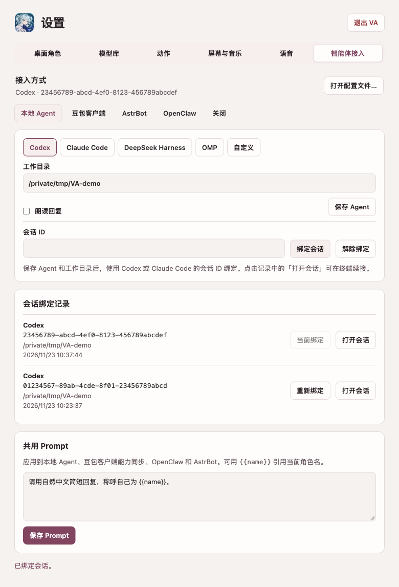

```sh
va integration local
va chat-use codex
va chat-bind <会话ID>
va config run chat-sessions --json
va config run chat-open-session '{"ref":"绑定记录返回的 ref","bind":true}'
va config run chat-restore-session '{"ref":"绑定记录返回的 ref"}'
va config run chat-unbind-session '{"ref":"绑定记录返回的 ref"}'
va config run chat-clear-sessions '{"provider":"omp"}'
va config run chat-create-session
va chat "我们刚才聊到哪里了？" --speak
```

### 角色 Prompt

在「设置 → 桌面角色 → 角色 Prompt」的输入框编辑角色背景、说话方式和动作命令。默认内容包含 `va actions --supported --json`、`va act wave`、`va act pose-heart`、三个舞步、表情和自拍示例。`{{actionCommands}}` 会根据当前模型和动作配置展开命令清单。Prompt 随桌面设置保存到 `~/Library/Application Support/VA Desktop/settings.json`，旧版配置中的人设和接入指令会在升级时合并到这个输入框。

用 `va config set character '{"prompt":"…"}'` 或 MCP 的 `va_config_set` 更新同一个输入框。运行 `va prompt` 可查看发送给本地 Agent 的完整版，`va prompt --voice` 输出豆包和机器人频道的版本。已绑定豆包客户端时，可点「同步角色能力」更新当前会话。OpenClaw 的同步仍通过插件选项 `workspacePrompt` 开启。[Prompt 与动作配置](docs/agent-custom-actions.md#对话如何触发动作)

接入配置保存在 `~/Library/Application Support/VA Desktop/agent.json`。命令行可用 `va integration [off|local|doubao-client|astrbot|openclaw]` 切换。自定义 Agent 在 `localAgent.custom.command` 填可执行文件的绝对路径，`args` 填参数。VA 通过 stdin 传入一行 JSON，其中包含 `message`、`prompt` 和 `sessionId`。适配器通过 stdout 返回带 `reply` 和 `sessionId` 的 JSON。屏幕观察请求的 `sessionId` 为 `null`，图片作为 `image.mime` 和 Base64 格式的 `image.data` 传入。

### 向本地 Agent 说话

在「设置 → 智能体接入 → 本地 Agent」选择 Agent 并绑定会话，然后在「向 Agent 说话」点「开始监听」。macOS 首次使用需要给 VA 开启麦克风权限。需要 macOS 26 和本机中文语音识别资源。[Apple Speech](https://developer.apple.com/documentation/speech)

Windows 使用独立的本机语音识别通路，不依赖 macOS 助手。请在 Windows 语言选项中安装语音识别组件，并在麦克风隐私设置中允许桌面应用访问麦克风。优先使用已安装的简体中文识别引擎，其次使用系统界面语言或其他已安装引擎；监听状态会显示实际识别语言。只在点击「开始监听」后使用默认麦克风。[Windows 语音识别引擎](https://learn.microsoft.com/en-us/dotnet/api/system.speech.recognition.speechrecognitionengine?view=netframework-4.8.1)

VA 在本机转写麦克风声音，将识别完成的文字自动发到绑定的会话。回复仍显示在角色旁，开启「自动朗读回复」即可听到回复。发送和朗读期间会暂停监听，结束后自动恢复。

macOS 上，DeepSeek Harness 的桌面 `standard` 会话由已打开的桌面客户端继续处理。首次使用或升级后如果 VA 提示同步角色能力，点「同步角色能力」，退出并重新打开 DeepSeek Harness，再开启监听。桌面会话沿用自身的权限和审批设置。

监听默认关闭，退出 VA 或变更 Agent、会话绑定时会停止。也可以在设置页点「停止监听」，或从 VA 菜单栏点「停止 Agent 语音输入」。

### 本机豆包客户端

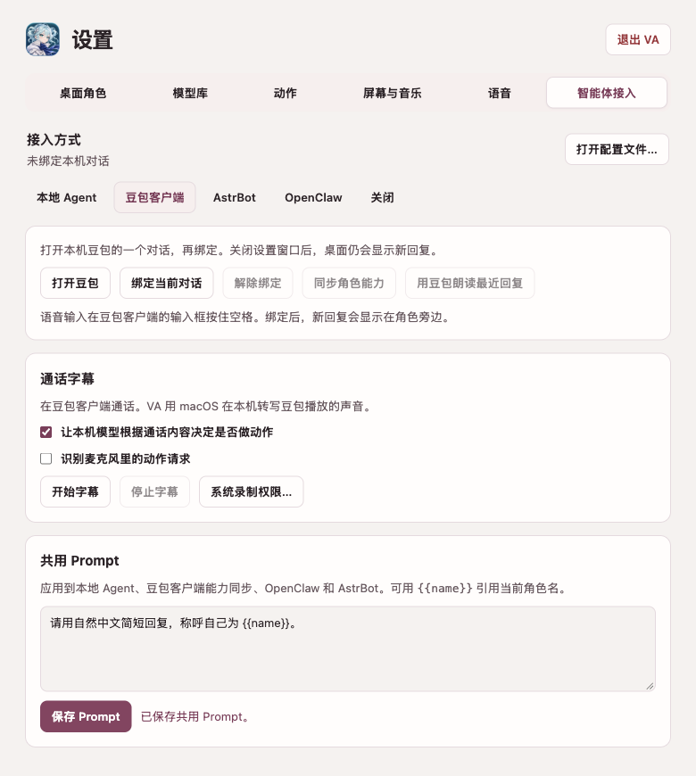

Windows：在豆包客户端登录并打开一条有聊天记录的对话，进入 VA「智能体接入 → 豆包客户端」点击「绑定当前对话」。支持读取新回复、使用 VA 当前音色朗读、从 VA 发文字及同步角色能力，也可调用豆包自己的朗读按钮。请保持绑定对话打开；输入框存在其他草稿或切换到另一条对话时会拒绝发送。Windows 构建会编译并携带独立的 .NET 客户端与字幕助手。

Windows 通话字幕（实验性）：先在豆包开始通话或朗读，再在 VA 勾选「允许采集默认扬声器的所有播放声音」并点「开始字幕」。此兼容实现会采集默认扬声器上的混合声音，包含其他应用，请暂停其他应用音频。需要 Windows 本机语音识别组件，优先使用中文；识别在本机进行，不保存录音。转写可能有同音错字，混合英文指令的准确度较差。字幕和口型跟随豆包原声，开启期间不再重复用 VA 音色朗读文字回复。切换输出设备后需要停止并重新开始。可选识别明确动作词；麦克风选项只处理本机动作请求，扬声器出声时抑制回声，建议戴耳机。下文的系统录音授权和 Apple 识别资源说明适用于 macOS。

Windows 可在「语音 → 语音识别」统一为智能体麦克风输入和豆包字幕选择本机 SenseVoice Small INT8，支持普通话和中英混说，使用语音活动检测按句显示字幕。[安装及引擎选择](WIN.md#可选的-sensevoice-中文字幕)。

在 macOS「系统设置 → 隐私与安全性」按所用功能授权。

| 功能 | 权限位置 | 授权给 |
| --- | --- | --- |
| 从 VA 发文字、读取对话回复、调用豆包的朗读按钮 | 辅助功能 | VA |
| 在豆包里打电话或按住空格说话 | 麦克风 | 豆包 |
| 在 VA 显示豆包的语音字幕和口型 | 录屏与系统录音 → 仅系统录音 | VA |
| 让 VA 在豆包客户端通话中识别你说的动作请求 | 麦克风 | VA |

如果「辅助功能」列表没有 VA，点「添加」并选择 `dist/VA-darwin-arm64/VA.app`。打开开关时，macOS 可能要求用触控 ID 或登录密码确认。「系统录制权限…」可以从 VA 的字幕设置页打开录制授权。

1. 在「智能体接入 → 豆包客户端」点「打开豆包」。用豆包内已登录的账号，打开一条已有对话。
2. 给 VA 开启「辅助功能」后，回到 VA 点「绑定当前对话」。关掉设置窗口后仍会在桌面显示新回复。切换接入方式、退出 VA 或点「解除绑定」会结束绑定。
3. 在豆包客户端发送文字或按住输入框的空格说话。新回复会显示在角色旁的桌面气泡里。「用豆包朗读最近回复」调用豆包客户端自己的朗读按钮。
4. 点「同步角色能力」或运行 `va chat-context`，把共用 Prompt、角色名称和动作说明发到绑定的豆包文字对话。从 VA 发本次绑定后的第一条普通消息时，也会附上能力说明。有在本机安排的跳舞请求时，VA 会在下一条发给豆包的文字里补充动作反馈。

如果同步角色能力或从命令行发送失败，先检查 VA 的「辅助功能」，再打开绑定的豆包对话并清理草稿。VA 会查找豆包的「发送」按钮，并确认豆包接受了输入；豆包输入框里已有其他草稿时会保留该草稿。

#### 打电话和字幕

1. 按上表给豆包开启麦克风，并给 VA 开启系统录音。字幕需要 macOS 26，首次启动时可能下载 Apple 的中文识别资源。[Apple 本机语音识别](https://developer.apple.com/documentation/speech/speechanalyzer)
2. 如果 VA 字幕已经开着，先点「停止字幕」。在豆包客户端选择「更多技能 → 打电话」，等电话接通。
3. 回到「VA → 智能体接入 → 豆包客户端」，点「开始字幕」。豆包播放下一句回复后，字幕会显示在角色旁的气泡和 VA 设置页。通话字幕适用于当前豆包客户端的声音，只有从 VA 发文字或同步某条对话的文字回复才需要绑定该对话。
4. 想在通话里直接让角色做动作时，开始字幕前勾选「识别麦克风里的动作请求」，并允许 VA 使用麦克风。VA 用本机转写判断你说的请求，识别后会播放对应动作。麦克风识别随字幕停止。

「同步角色能力」会在绑定的文字对话中留下一条消息。豆包客户端的通话模式如何使用文字历史由豆包决定。

VA 通过 Core Audio 采集豆包及其音频助手的输出，中文转写在 Mac 本机完成。豆包的播放音量也会驱动角色口型、点头和说话手势。字幕只包含豆包播放的声音，麦克风仍由豆包客户端使用。关闭 VA 设置窗口后字幕可继续显示。点「停止字幕」、退出 VA 或切换接入方式会释放音频采集。

字幕状态会依次显示等待豆包出声、已收到音频和正在显示字幕。可以在豆包选一条回复点「朗读」测试。听到朗读后如果仍停在等待状态，可以用同页的「系统录制权限…」检查授权。打电话接不通时，可以先停止字幕、重启豆包，再按上述顺序重拨。

打开「让本机模型根据通话内容决定是否做动作」时，VA 把识别完成的片段交给 Mac 上的模型判断。优先用 Apple Intelligence。Apple Intelligence 不可用时使用 macOS 的中文句向量模型，在语义与表演请求或舞蹈庆祝足够接近时触发。设置页会提示所用方式。这个判断由 VA 在本机依据豆包的语音回复完成。[Apple 设备端模型](https://developer.apple.com/documentation/foundationmodels/systemlanguagemodel)

## OpenClaw 和 AstrBot

启动 VA，在「设置 → 智能体接入」选择 OpenClaw 或 AstrBot。机器人沿用自己配置的语言模型，VA 显示绑定频道的回复。开启「朗读机器人回复」后，角色会发声并同步口型。

插件源码随仓库提供。`dist/` 是本机生成的目录，从 GitHub 克隆或下载源码后，在仓库根目录执行以下命令即可生成安装包。

```bash
bash scripts/package.sh integrations
```

### 安装 OpenClaw 插件

在 OpenClaw Gateway 所在的运行环境进入 VA 仓库，执行以下命令直接使用插件源码。也可以把打包命令生成的 `dist/integrations/openclaw-va-desktop-<版本>.tgz` 放到 Gateway 所在的环境，用 `openclaw plugins install` 安装该文件。[OpenClaw 插件安装](https://docs.openclaw.ai/cli/plugins/install)

```bash
openclaw plugins install --link "$PWD/integrations/openclaw"
```

插件 ID 是 `va-desktop`。在配置里把 `command` 数组指向 Gateway 能调用的 VA 命令，例如同机运行时用 `["va"]`。在目标频道以授权账号发送 `/va route`，将返回的 `channel`、`target`、`accountId` 和 `sessionKey` 填入 VA。

### 安装 AstrBot 插件

运行上述打包命令后，在 AstrBot 管理面板的「插件 → 安装插件 → 从文件安装」上传 `dist/integrations/astrbot_plugin_va.zip`。设置插件的 `command` 为 Bot 能执行的 VA 命令，例如同机运行时用 `va`。在目标频道以授权账号发送 `/va route`，将返回的 UMO 填入 VA 的「目标频道」。[AstrBot 插件安装](https://docs.astrbot.app/use/plugin.html)

| OpenClaw 频道设置 | AstrBot 频道设置 |
| --- | --- |
| 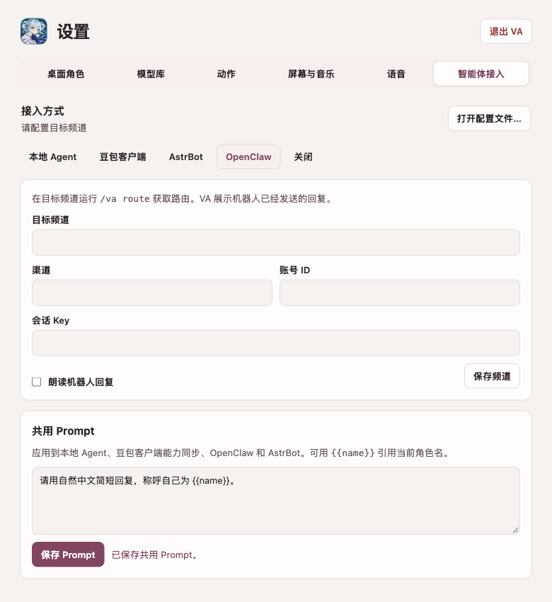 | 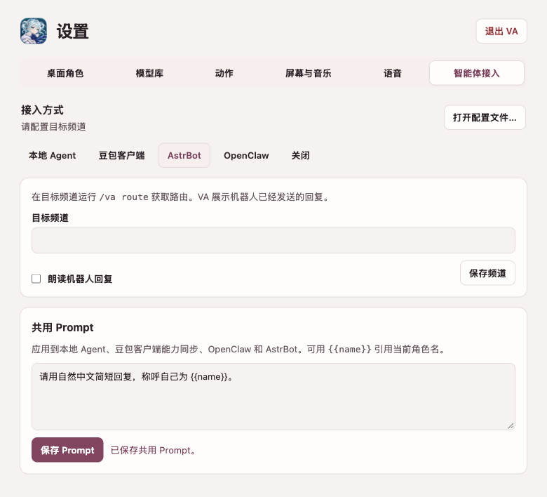 |

Bot 与 VA 同机运行时使用同一个 macOS 登录用户。远端 Bot 可通过 SSH 调用 VA，Docker 可使用仓库里的 [目录桥接](integrations/docker/bridge.py)。两个 Bot 共用一个 Telegram token 时，每次只开启一个 Bot 的 Telegram 适配器。[桥接参数和排查](integrations/README.md)

OpenClaw 按频道的配对或访问策略授权，AstrBot 允许管理员或插件 `allowed_user_ids` 中的账号控制角色。配对后，授权账号可直接在频道输入以下命令。

| 发送 | 结果 |
| --- | --- |
| `/va selfie` | VA 摆拍，机器人只发回一张 780 × 1040 的透明 PNG。桌面角色隐藏时也能拍。 |
| `/va act dance` | 桌面角色跳经典律动并播放默认对白。动作名也可用 `dance-side`、`dance-spin` 或 `dance-bounce`。 |
| `/va act wave` | 桌面角色挥手并播放默认对白。 |
| `/va say 你好，很高兴见到你` | 桌面角色显示这句台词并朗读。 |

在 VA 配置的 OpenClaw 或 AstrBot 频道里，授权用户发「跳个舞吧」即可让 VA 表演。插件在机器人调用模型前处理这条请求。AstrBot 注册了 `va_desktop_selfie`，Agent 调用后会把照片发到当前频道。也可以用表中的命令直接自拍或选舞步。

绑定 Telegram 后，可以直接发「给我发张自拍」。AstrBot 和 OpenClaw 都会在调用模型前让 VA 拍照，把 PNG 作为唯一回复发回绑定的聊天。更新 Docker 中的机器人插件后，重启对应的容器让修改生效。

给 VA 单独配置了 OpenClaw 工作区时，可开启 `plugins.entries.va-desktop.config.workspacePrompt`。VA 会在绑定对话进入模型前，把共用 Prompt、当前角色名和动作清单同步到 `agents.defaults.workspace` 下 `SOUL.md` 的 VA 区块。`SOUL.md` 会用于该工作区的会话。AstrBot 会在授权账号的绑定对话里自动追加同样的 Prompt。机器人发出的「我来挥手」等回复会在 VA 上触发对应动作。[OpenClaw 工作区](https://docs.openclaw.ai/concepts/agent-workspace)

## 视觉 Agent 与系统音乐

在 VA 的「设置 → 屏幕与音乐」分别开启屏幕观察和音乐跟随。两项功能默认关闭，角色隐藏时暂停。观察间隔可选 `10s`、`30s`、`1min`、`5min`、`10min`、`30min`、`1h`、`6h`、`24h`，默认 `10s`。截屏按间隔发起，分析较慢时只保留一张最新待处理截图。也可用 `va sense interval 30`、`va sense screen on` 和 `va sense music on`，状态可用 `va senses --json` 查询。首次使用时，在 macOS 的「隐私与安全性 → 屏幕与系统音频录制」授权 VA，然后退出并重新启动。源码模式下，macOS 可能将授权归给启动 VA 的终端。

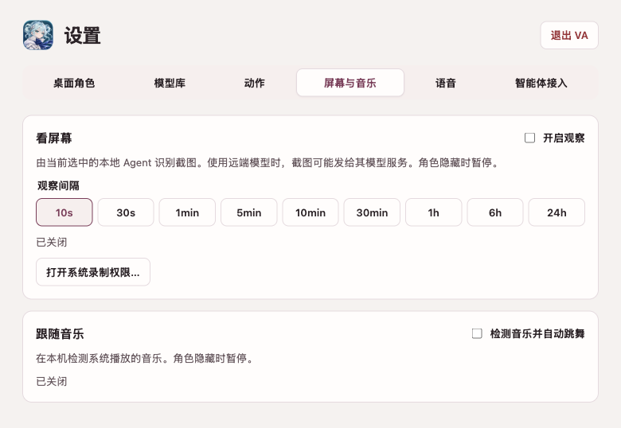

屏幕观察把截图交给当前选择的本地 Agent。Agent 使用远端服务时，画面可能由 Agent 发给其模型服务。切换到豆包客户端或机器人频道时，屏幕观察会暂停。MCP 客户端可用 `va_observe` 请求一次观察并取得文字结果，用 `va_senses` 查看状态。

macOS 上已选用一种交互接入时，可独立开启音乐跟随。音频分类在本机进行。

音乐识别使用 macOS 的本机音频分类，分析系统输出。检测到音乐会播放角色的预设舞步，音乐停止或关闭开关时会停下。鼠标穿透关闭时，点角色可以打断自动动作并播放摸头动作。桌面打包会编译音频组件，源码开发可用 `make dev` 编译并启动。

## 摄像头拍照与问答

```bash
va camera --out /tmp/va-camera.jpg
va camera --ask '照片里有哪些物品？' --agent codex
```

`va camera` 使用默认摄像头，只拍一张 JPEG，拍完释放摄像头。首次使用时按操作系统提示授权。加上 `--ask` 会把照片和问题交给配置的视觉 Agent，并返回答案。支持 Codex、Claude Code、OMP 和能接收图片的自定义 Agent。可用 `--agent` 和 `--model` 临时指定本次使用的 Agent 或模型。问答在独立请求中进行，使用远端模型时照片会发送给该服务。问答时同时指定 `--out` 可以保存照片。

MCP 的 `va_camera` 可以把 JPEG 交给当前调用的 Agent。传入 `question` 时，由 VA 发起照片问答并返回文字答案。

## 语音和口型

「设置 → 语音」可选择**本机音色**、**本地音色复刻**或**火山 TTS**。选择本机音色后，点击「搜索本机音色或语言」即可浏览列表，也可以输入「中文」或「婷婷」来筛选。VA 会先显示上次读取的音色，再在后台更新列表。当前选择会自动保存，「试听当前音色」会播放测试台词。更多音色可在 macOS「系统设置 → 辅助功能 → 阅读与朗读 → 系统声音」中下载，完成后回到 VA 点「刷新」。命令行可用 `va config run system-voices --json` 查看音色名称，再用 `va config set voice '{"provider":"system","systemVoice":"Tingting"}' --json` 切换。[Apple 朗读音色设置](https://support.apple.com/zh-cn/guide/mac-help/mchlp2290/mac)

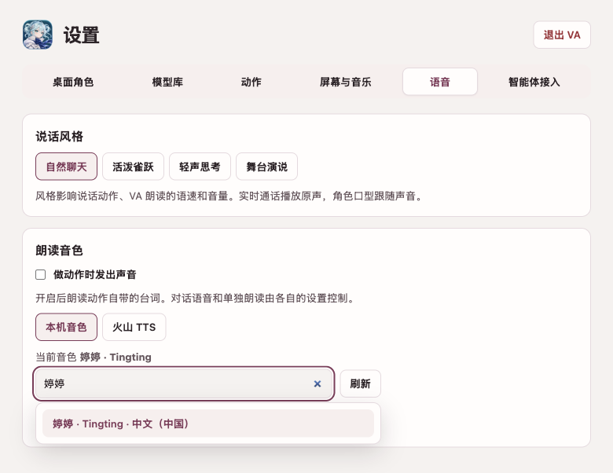

同一页的「说话风格」可选自然聊天、活泼雀跃、轻声思考或舞台演说。风格会调整说话动作以及 VA 朗读的语速和音量。「活泼雀跃」说得更快、抬手更频繁，「轻声思考」会放慢、降低音量并歪头，「舞台演说」手势更开阔。豆包客户端通话的口型跟随客户端播放的原声。

音频就绪时，台词气泡与动作一起出现，口型随朗读声音动。同一句台词使用相同的服务、音色和风格时会重用已经合成的音频。缓存只保留在本次 VA 运行的内存中。

### 本地音色复刻

VA 使用 **Sherpa-ONNX + ZipVoice-Distill INT8** 从参考录音复刻音色，支持中文和英文。VA 启动时会后台加载已启用的模型。用 Apple M4 的 4 个 CPU 线程和一段 3.3 秒参考音测试，预热后的三条 15–25 字中文台词约 0.61–0.99 秒生成完整音频。[ZipVoice 模型和示例](https://k2-fsa.github.io/sherpa/onnx/tts/zipvoice.html)

1. macOS 可在项目目录运行 `make zipvoice-tts`，安装器会在 `~/Library/Application Support/VA Desktop/zipvoice-tts` 创建 Python 虚拟环境并下载模型。Windows 用户在「运行路径」中填写已安装 sherpa-onnx 的 Python 和模型目录。参考录音要使用 24 kHz 单声道 16 位 PCM WAV，也可安装 FFmpeg 并将其加入 PATH，由 VA 处理其他 WAV、M4A 和 MP3。详情见 [Windows 适配说明](WIN.md)。
2. 打开「设置 → 语音 → 本地音色复刻」，选择约 3 秒的清晰人声录音，支持 WAV、M4A、MP3。填写这段录音的准确原文，点「保存并使用 ZipVoice」，再点「试听当前音色」。VA 会按原路径读取录音。
3. 对话沿用各接入的朗读开关。要朗读动作台词，打开「做动作时发出声音」。口型会跟随合成音频。日常合成失败时会回退到系统音色，试听会显示错误。

录音和朗读文本在本机处理。CLI 和 MCP 也能配置同一音色。

```bash
va config set voice '{"provider":"zipvoice","zipvoice":{"referenceAudio":"/path/to/reference.wav","referenceText":"你好，我在这里。"}}' --json
```

### 开启火山 TTS

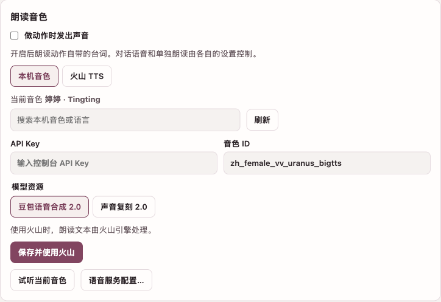

1. 在火山引擎开通语音合成，准备 API Key 和该资源支持的 Speaker ID。标准语音合成选择 `seed-tts-2.0`。已有火山复刻音色时，选择 `seed-icl-2.0` 并填写该音色的 Speaker ID。[火山语音合成接口](https://docs.volcengine.com/docs/doubao-voice/unidirectional-streaming-text-to-speech-http?lang=zh)
2. 在「设置 → 语音」选择「火山 TTS」，填入 API Key 和 Speaker ID，选中资源，再点「保存并使用火山」。API Key 也可通过 VA 启动进程的 `VOLC_TTS_API_KEY` 提供。
3. 点击「试听当前音色」确认可播放。要听 Telegram 的机器人回复，在 VA 的频道配置中打开「朗读机器人回复」。

VA 通过 HTTPS 将朗读文本提交给火山引擎。语音设置保存在 `~/Library/Application Support/VA Desktop/voice.json`，也可通过 `VA_VOICE_CONFIG` 指定位置。火山服务请求失败时，日常对白回退到系统音色，试听会显示错误。

## 半身视角

「设置 → 角色视角」可选择全身或半身，重启会恢复上次视角。也可执行 `va view portrait` 或 `va view full`。

## 许可证

VA 源码采用 Apache License 2.0。第三方模型及其展示素材按各自的许可证使用。[Apache License 2.0 全文](LICENSE) · [模型授权与署名](assets/models/ATTRIBUTION.md)

## 感谢

感谢 LINUX DO 社区为开源项目提供交流与分享的空间。 [LINUX DO](https://linux.do/)
