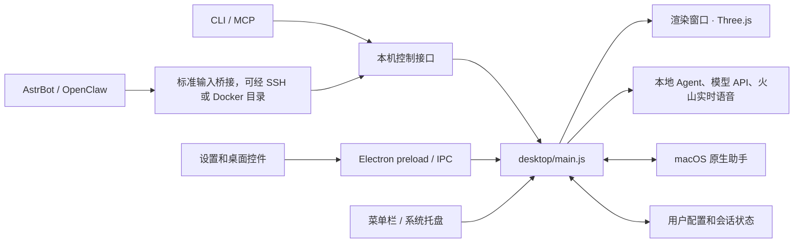

# VA 代码结构

VA 是 Electron 桌面应用。主进程管理角色窗口、设置、会话及设备权限，渲染进程用 Three.js 加载模型并播放动作。CLI、MCP 和机器人插件通过本机控制接口调用同一个主进程。macOS 的 Swift 助手负责设备音频、转写与豆包客户端联动。

## 目录职责

| 位置 | 职责 |
| --- | --- |
| [`desktop/main.js`](../desktop/main.js)、[`desktop/preload.cjs`](../desktop/preload.cjs) | Electron 启动与退出，窗口生命周期，IPC 校验，各接入方式的切换，以及动作、语音和传感器调度。 |
| [`desktop/renderer.js`](../desktop/renderer.js)、[`desktop/avatar.js`](../desktop/avatar.js) | 渲染端命令，角色姿势、动画和表情，口型、拍照与鼠标互动。设置、气泡和桌面控制条分别使用独立窗口。 |
| [`desktop/model-files.js`](../desktop/model-files.js)、[`desktop/model-loaders.js`](../desktop/model-loaders.js)、[`desktop/model-library.js`](../desktop/model-library.js) | 模型路径与贴图资源解析，格式加载与预览，AI 娘模型包导入，以及模型库记录。 |
| [`desktop/actions.js`](../desktop/actions.js)、[`desktop/performance-config.js`](../desktop/performance-config.js)、[`desktop/character-performance.js`](../desktop/character-performance.js) | 默认动作和表情，用户配置合并与校验，模型兼容性清单，以及把对话输入和输出映射为动作。 |
| [`desktop/integration.js`](../desktop/integration.js)、[`desktop/local-agent.js`](../desktop/local-agent.js)、[`desktop/api-profiles.js`](../desktop/api-profiles.js)、[`desktop/vision-agent.js`](../desktop/vision-agent.js) | 接入方式、频道路由、本地 Agent 子进程、会话绑定、API 配置和模型协议适配。 |
| [`desktop/senses.js`](../desktop/senses.js)、[`desktop/doubao.js`](../desktop/doubao.js)、[`desktop/speech.js`](../desktop/speech.js)、[`desktop/volc-tts.js`](../desktop/volc-tts.js) | 屏幕观察与音乐检测调度、火山实时语音，以及系统音色和火山 TTS。豆包客户端的联动、字幕和播放由 `doubao-client.js`、`doubao-captions.js` 与 `doubao-playback.js` 协作处理。 |
| [`bin/va.js`](../bin/va.js)、[`lib/`](../lib) | 参数解析、MCP 工具注册、`va bridge`、桌面进程启动及本机控制协议。 |
| [`integrations/`](../integrations)、[`skills/va-desktop/`](../skills/va-desktop) | AstrBot、OpenClaw 插件与 Docker 目录桥接，以及 Agent 使用 VA 的操作说明。 |
| [`native/`](../native) | `AudioMonitor.swift` 负责系统音乐检测。`DoubaoClient.swift` 通过辅助功能访问本机豆包客户端。`DoubaoCaptions.swift` 负责音频采集、实时转写与设备端动作判断。 |
| [`config/`](../config)、[`scripts/`](../scripts)、[`Makefile`](../Makefile) | 初始配置、Electron 打包、Swift 助手构建和 Blender 模型转换。参考音色实验脚本也位于 `scripts/`。 |

## 常见链路

### 模型与动作

模型先由 `bindModel` 校验路径及格式，并登记在 `va-app://desktop/assets/` 下。渲染端加载模型后会试渲染并报告骨骼、动画、表情目标及口型能力。用户切换模型时，主进程先要求渲染端检查，确认后再激活并保存路径。`model-check` 走同一检查流程，检查完成后释放临时模型。

`performance-config.js` 将内置目录与用户的 `performance.json` 合并。`va actions --reload`、设置页和 MCP 均可重载同一份配置。CLI 根据最新目录解析动作编号和显示名称，再把编号发给主进程。主进程把动作、默认或覆盖表情、骨骼偏移和对白组织为一次表演，渲染端据此播放。主进程同时管理手动任务、入站动作、回复表演及音乐跟随的调度。

`va photo` 采集当前渲染画布。`va selfie` 先进入摆拍动作，再用专门的相机取景，输出透明 PNG。机器人插件将 PNG 转成频道附件。

### 对话与角色设定

一次启用一种对话接入。Codex、Claude Code、DeepSeek Harness、OMP 和自定义 Agent 通过本机子进程运行。API 接入支持 OpenAI Chat、OpenAI Responses 和 Anthropic Messages。主进程根据角色名称、人设和当前动作清单生成 Prompt。明确的动作请求可先在本机处理，Agent 的回复也可附动作与表情。

AstrBot 和 OpenClaw 使用各自的模型和频道发送能力。插件通过 `va bridge` 转交入站动作、Prompt 请求与已发送的频道回复。直连和 SSH 走标准输入输出，Docker 方式先写共享目录，再由宿主机调用同一入口。频道绑定存放在 `agent.json`。

### 麦克风、系统音频与屏幕

豆包客户端通话的输出由 macOS 助手转写并回传字幕和音量。可单独开启麦克风动作请求识别或本机动作判断。火山实时语音从 Electron 采集麦克风，使用 WebSocket 发送音频并在渲染端播放返回的音频流。

屏幕观察由 `senses.js` 调度，`desktopCapturer` 获取主显示器图像，由当前本地 Agent 或当前模型 API 配置的视觉模型识别。切换接入会丢弃上一接入的在途截图和待播放观察结果。`va_observe` 通过相同链路发起一次观察并返回文字结果。

## 配置与运行边界

应用将 Electron 的 `userData` 设为系统应用数据目录下的 `VA Desktop`。仓库中的 `config/` 提供初始模板。下表列出常用的运行配置。

| 文件 | 内容 | 覆盖路径 |
| --- | --- | --- |
| `settings.json` | 模型路径、视角、缩放、主题、屏幕与音乐选项 | 使用 `userData` 下的默认路径 |
| `agent.json` | 当前接入方式、Agent、模型 API 和机器人频道 | `VA_AGENT_CONFIG` |
| `character.json` | 角色名、人设、默认台词 | `VA_CHARACTER_CONFIG` |
| `performance.json` | 用户动作及表情 | `VA_PERFORMANCE_CONFIG` |
| `voice.json` | 音色服务、参考录音和动作发声设置 | `VA_VOICE_CONFIG` |
| `ai-girls.json`、`local-agent-sessions.json` | 导入的模型目录和按 Agent 配置保存的会话 ID | 使用 `userData` 下的默认路径 |

Electron 渲染窗口启用沙箱和上下文隔离，使用 preload 暴露受控 IPC。macOS CLI 通过用户独占的 Unix socket 接入，Windows 通过回环 TCP 和本机连接文件里的随机 token 接入。机器人频道的身份来自机器人平台，VA 主进程提供频道路由和接入模式判断。

主进程通过 [lib/logger.js](../lib/logger.js) 把运行事件写入启动目录的 `logs/va.log`。调用方只传入诊断字段，例如动作编号、接入方式、状态和错误码。运行日志和单测文件会在应用打包时排除。

## 开发入口

`make dev` 在 macOS 编译 Swift 助手并从源码启动，Windows 可运行 `npm start`。`npm test` 运行 `test/` 下的单测。`npm run build:mac` 和 `npm run build:win` 通过 `scripts/build.js` 生成 Electron 包。`make integrations` 单独打包两个机器人插件。动作配置示例见 [Agent 自定义动作指南](agent-custom-actions.md)，插件部署参数见 [机器人接入指南](../integrations/README.md)。
